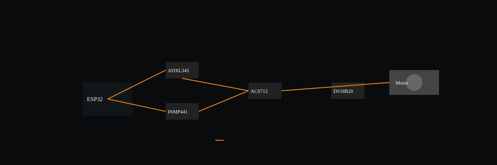
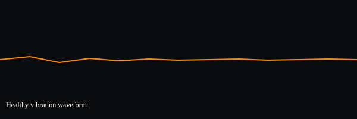
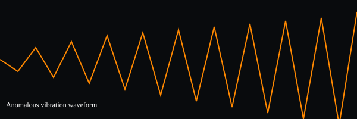
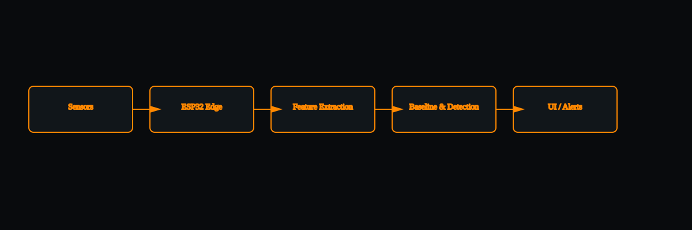

# MachineVaidya

  <!-- Hero video – replace `hero-video.mp4` with a real clip when available -->
  <video autoplay loop muted playsinline style="width:100%;max-width:1200px;border-radius:8px;" poster="assets/machinevaidya-hero.svg">
    <source src="assets/hero-video.mp4" type="video/mp4">
    Your browser does not support the video tag.
  </video>
  <h1 style="font-size:3rem;margin:1rem 0;color:#ff8800;">Machines don’t fail without warning. The warning just goes unnoticed.</h1>
  

    An affordable offline AI health‑monitor for small‑factory machines. Low‑cost sensors learn the normal behaviour of each motor and raise clear, actionable alerts the moment something changes.
  

  
<strong>Problem 4.3 – Tech4Bharat Hackathon</strong> – Small factories lose production to unseen breakdowns.

  
<em>Status: prototype / concept in development</em>

  <nav style="margin-top:1.5rem;">
    <a href="#the-problem" style="margin-right:1.5rem;color:#ff8800;">The Problem</a>
    <a href="#our-approach" style="margin-right:1.5rem;color:#ff8800;">Our Approach</a>
    <a href="#sensor" style="margin-right:1.5rem;color:#ff8800;">The Sensor</a>
    <a href="#signature" style="margin-right:1.5rem;color:#ff8800;">Signature</a>
    <a href="#architecture" style="margin-right:1.5rem;color:#ff8800;">Architecture</a>
    <a href="#ui" style="margin-right:1.5rem;color:#ff8800;">Interface</a>
    <a href="#demo" style="margin-right:1.5rem;color:#ff8800;">Demo</a>
    <a href="#technical" style="margin-right:1.5rem;color:#ff8800;">Technical</a>
    <a href="#validation" style="margin-right:1.5rem;color:#ff8800;">Validation</a>
    <a href="#roadmap" style="color:#ff8800;">Roadmap</a>
  </nav>

---

## The Problem

  
  

    <ul style="font-size:1.1rem;line-height:1.6;">
      <li>Small workshops rely on sound, feel and occasional manual checks.</li>
      <li>Commercial predictive‑maintenance platforms cost thousands and need constant cloud connectivity.</li>
      <li>Unplanned downtime directly erodes the owner’s profit.</li>
    </ul>
  

---

## Our Approach

MachineVaidya creates a **per‑machine baseline** from inexpensive on‑device sensors (vibration, acoustic, current, temperature). Any deviation from this learned signature triggers an **explainable anomaly alert** that points out *what* changed (frequency band, current spike, temperature rise, etc.).

---

## The Sensor (product reveal)

*All components are soldered onto a compact PCB that clips onto the motor housing. The ESP32 streams pre‑processed features over Wi‑Fi to the companion device.*

---

## The Machine’s Signature

<table style="width:100%;border-collapse:collapse;">
  <tr>
    <th style="width:50%;padding:0.5rem;background:#11161A;color:#fff;">Healthy</th>
    <th style="width:50%;padding:0.5rem;background:#11161A;color:#fff;">Anomaly</th>
  </tr>
  <tr>
    <td style="padding:0.5rem;text-align:center;">
      
    </td>
    <td style="padding:0.5rem;text-align:center;">
      
    </td>
  </tr>
</table>

**What changes?**
- New high‑frequency components appear.  
- Vibration amplitude spikes.  
- Current draw becomes erratic.  
- Temperature may rise.

---

## How MachineVaidya Thinks (architecture)

### Detailed Flow (step‑by‑step)

*The diagram distinguishes:*  
- **Sensor acquisition** on the ESP32 (raw ADC/I²S samples).  
- **Edge DSP** (RMS, FFT, band‑energy) performed locally.  
- **Feature transmission** over encrypted Wi‑Fi to the companion.  
- **Companion service** (Python, FastAPI) stores windows in SQLite, updates the baseline, runs Isolation‑Forest detection.  
- **Explanation layer** computes feature importance and builds a natural‑language alert.  
- **UI/Alerts** – PWA shows health score, trend graphs, and triggers a local voice warning.  
- **Future agent** – optional LangChain‑style maintenance assistant.

---

## Product Interface (concept mock‑ups)

### Mobile view (prototype)

### Desktop dashboard (prototype)

*All UI sketches are conceptual – replace with real screenshots once the PWA is built.*

---

## Live Demonstration (storyboard)

  

1. **Learn** – Capture 10 min of normal operation; the system builds a baseline model.  
2. **Change** – Introduce a controlled fault (e.g., loosen a bearing).  
3. **Detect** – The Isolation‑Forest flags the new high‑frequency component (see the red spike in the waveform).  
4. **Act** – A colour‑coded UI alert appears, a voice prompt in Kannada/Hindi plays, and a maintenance recommendation is generated.

*All data in the demo are synthetic or drawn from open‑source benchmark sets.*

---

## Technical Details

Hardware (Bill of Materials)

| Component | Approx. cost (₹) | Function |
|---|---|---|
| ESP32‑DevKitC | 300 | Edge compute, Wi‑Fi |
| ADXL345 accelerometer | 150 | Vibration sensing |
| INMP441 microphone | 120 | Acoustic monitoring |
| ACS712 current sensor | 100 | Motor current |
| DS18B20 temperature probe | 80 | Thermal monitoring |
| Misc. wiring/PCB | ~150 | Integration |
| **Total (estimate)** | **≈ ₹ 1 000** | – |

Signal processing & detection

- **Feature extraction** – RMS, peak‑to‑peak, spectral centroid, kurtosis, band‑energy, moving‑average of current.
- **Baseline model** – per‑machine Gaussian statistics updated nightly.
- **Anomaly detector** – Isolation Forest (Scikit‑learn) runs on the companion (Raspberry Pi or laptop).
- **Future extensions** – Auto‑encoder, drift‑aware recalibration, ensemble of detectors.
- **Explainability** – SHAP‑like importance scores displayed in the UI.

Offline‑first stack

- **Edge** – ESP32 collects raw samples at 1 kHz (vibration) and 44.1 kHz (audio).  
- **Companion** – Python 3.11, FastAPI, SQLite stores sliding windows of features; all inference runs locally.
- **Analytics** – NumPy, SciPy, Scikit‑learn for statistical processing.
- **Frontend** – PWA built with React + Vite; works on any device connected to the local Wi‑Fi network, no cloud required.

---

## Validation Plan

- **Datasets** – CWRU bearing, NASA IMS, MIMII acoustic.  
- **Metrics** – detection latency, false‑alarm rate, precision/recall, lead‑time before failure.  
- **Success criteria** – latency ≤ 2 s, false‑alarm ≤ 5 %, precision ≥ 80 %.

*Experimental results will be added after Phase 6.*

---

## Roadmap (timeline)

| Phase | Milestone |
|------|-----------|
| **1** | Sensor prototype & motor test‑bench |
| **2** | Baseline learning & Isolation‑Forest detector |
| **3** | Health visualisation & offline alerts |
| **4** | Multilingual voice alerts (Kannada, Hindi) |
| **5** | Maintenance‑assistant prototype (LangChain‑style) |
| **6** | Field validation with small manufacturers |

---

## Closing

> *“Small factories deserve the same machine intelligence as large industrial plants.”*

**MachineVaidya** – built for machines that keep small businesses running.

---

**Problem 4.3 – Tech4Bharat Hackathon – Industrial Manufacturing**

---

### How to preview locally
1. Open the repository in VS Code and press **Ctrl + Shift + V** (or *View → Open Preview*).  
2. All SVGs, the placeholder MP4 video and GIF will render inline.  
3. Replace the placeholder assets (`hero-video.mp4`, `demo-loop.gif`, `mobile-concept.svg`, `dashboard-concept.svg`) with real media – the README will update automatically.

---

*All visual assets live in the `assets/` folder. Replace the placeholders with high‑resolution photos or actual recordings to complete the cinematic experience.*
---

### How to preview locally
1. Open the repository in VS Code and press **Ctrl + Shift + V** (or *View → Open Preview*).  
2. All SVGs, the placeholder MP4 video and GIF will render inline.  
3. Replace the placeholder assets (`hero-video.mp4`, `demo-loop.gif`, `mobile-concept.svg`, `dashboard-concept.svg`) with real media – the README will update automatically.

---

*All visual assets live in the `assets/` folder. Replace the placeholders with high‑resolution photos or actual recordings to complete the cinematic experience.*
