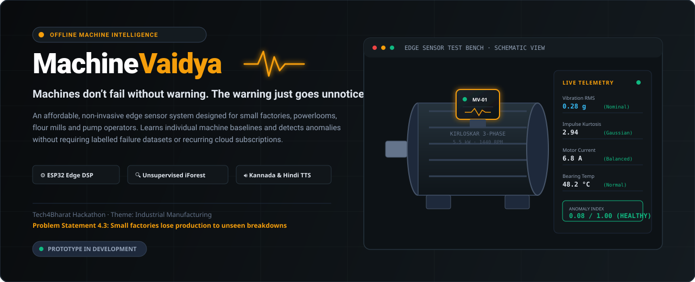
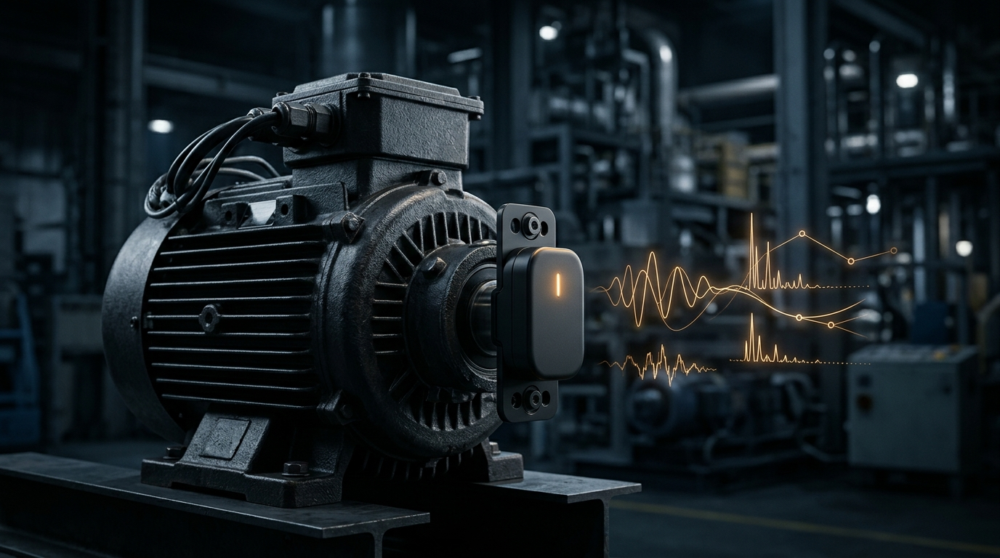
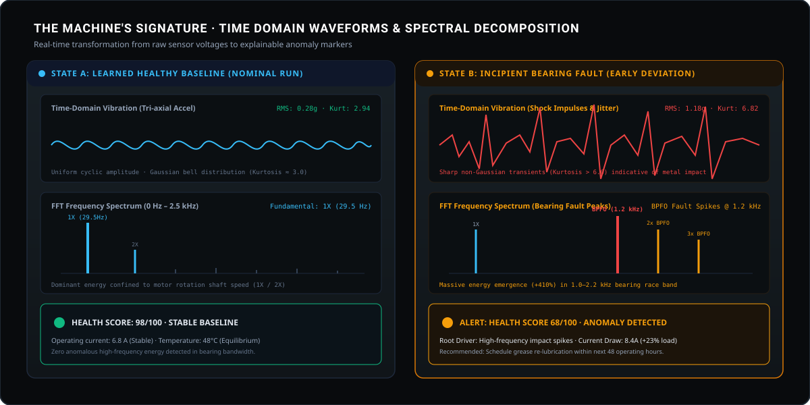
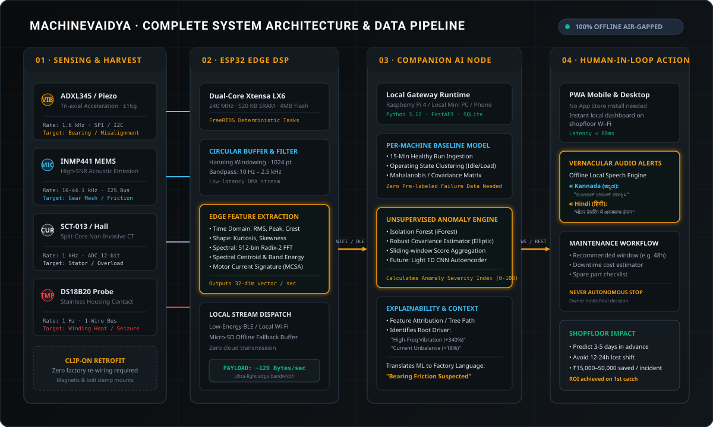
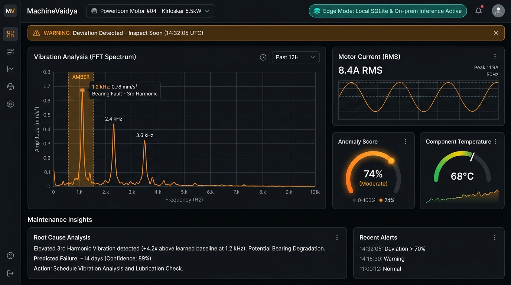
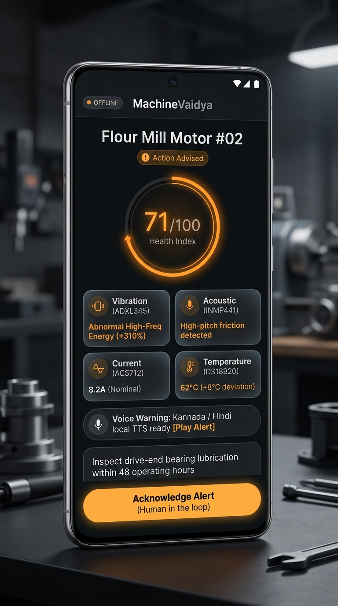
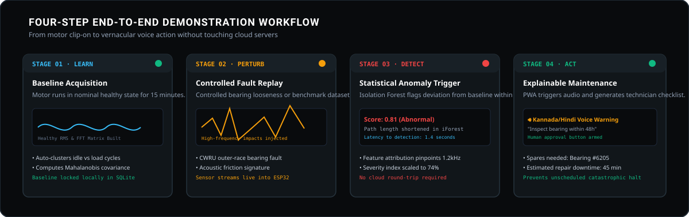

<p align="center">
  
</p>

<p align="center">
  <strong>Offline AI Health Monitor for Small Factory Machines</strong><br>
  <em>Tech4Bharat Hackathon · Theme: Industrial Manufacturing · Problem Statement 4.3</em>
</p>

<p align="center">
  <a href="#the-problem">The Problem</a> •
  <a href="#the-sensor-system">The Sensor</a> •
  <a href="#the-machines-signature">Machine Signature</a> •
  <a href="#how-machinevaidya-thinks">Architecture</a> •
  <a href="#product-interfaces">Interfaces</a> •
  <a href="#live-demonstration">Demo Scenario</a> •
  <a href="#intelligence--dsp">Intelligence &amp; DSP</a> •
  <a href="#validation-plan">Validation</a> •
  <a href="#roadmap">Roadmap</a>
</p>

<p align="center">
  
  
  
  
  
</p>

---

> **"Machines don’t fail without warning. The warning just goes unnoticed."**  
>
> MachineVaidya brings industrial-grade predictive intelligence to small workshops, powerlooms, flour mills, and agricultural pump sets that cannot afford five-lakh-rupee cloud SCADA platforms. It clips onto existing equipment without rewiring, learns the unique baseline signature of each individual machine, and alerts operators before mechanical degradation becomes catastrophic downtime.

---

## The Problem

Small manufacturing units form the backbone of industrial production across India, yet they operate under continuous vulnerability to unplanned mechanical failure:

```
[Normal Production] ──► [Undetected Micro-Degradation] ──► [Sudden Bearing Breakdown] ──► [Lost Shifts & Revenue]
      3 shifts/day             Subtle 1.2 kHz harmonics             Winding / shaft seizure           ₹20k–₹80k loss per incident
```

* **Reliance on Human Sensory Experience**: Factory owners rely on touching motor housings or listening for unusual pitch changes. By the time human senses detect an anomaly, severe metal-to-metal damage has already occurred.
* **Prohibitive Economics of Legacy Telemetry**: Commercial predictive maintenance systems require proprietary sensor networks, dedicated edge gateways, and recurring cloud subscriptions costing hundreds of dollars per machine monthly.
* **Connectivity Bottlenecks**: Tier-2 and rural industrial clusters experience frequent cellular dropped packets and intermittent broadband. Systems dependent on continuous cloud ingestion fail silently during network dropouts.
* **The Reality of Unplanned Stoppage**: For a loom or milling unit running tight delivery deadlines, an unpredicted 12-hour breakdown halts customer deliveries, incurs emergency technician call-out surcharges, and risks contract cancellation.

---

## The Sensor System

MachineVaidya is engineered as a non-invasive, clip-on edge module. It requires zero electrical rewiring, zero machine modification, and mounts directly to the motor end-shield or bearing housing using industrial magnetic brackets.

<p align="center">
  
</p>
<p align="center"><em>Physical concept representation: Matte-black clip-on sensor module securely mounted to electric motor bearing casing with ambient telemetry pulse.</em></p>

<p align="center">
  
</p>

### Bill of Materials & Sensor Roles

| Subsystem | Component | Bus / Protocol | Operational Role | Target Fault Signatures | Est. Cost (INR) |
|:---|:---|:---|:---|:---|:---:|
| **Edge Compute** | ESP32-WROOM-32 (240 MHz Dual Core) | SPI / I2C / I2S / ADC | Sampling orchestration, FreeRTOS DSP tasks, feature extraction, local WiFi/BLE packet dispatch | Master edge coordinator | ₹300 |
| **Vibration Sensor** | ADXL345 (3-Axis MEMS Accelerometer) | I2C / SPI (1.6 kHz ODR) | Captures high-frequency acceleration impulses and casing vibration | Bearing race spalling, shaft unbalance, mechanical looseness | ₹150 |
| **Acoustic Sensor** | INMP441 (Omnidirectional MEMS Mic) | I2S Digital Bus (16–44.1 kHz) | Monitors ultra-high frequency acoustic emission without analog noise pickup | Gear mesh friction, cavitation, high-frequency metal grinding | ₹120 |
| **Current Sensor** | SCT-013 / Hall-Effect Clamp | 12-bit ADC (1 kHz) | Measures non-invasive AC current draw (Motor Current Signature Analysis) | Phase imbalance, rotor bar broken faults, continuous overload | ₹100 |
| **Thermal Probe** | DS18B20 (Stainless Probe) | 1-Wire Digital Bus | Contact surface temperature tracking with ±0.5°C accuracy | Thermal runaway, inadequate bearing lubrication, winding heat | ₹80 |
| **Housing & Mount** | Industrial Enclosure + Magnetic Mount | N/A | Vibration-transmissive mounting bracket with IP54 workshop protection | Mechanical coupling directly to motor casing | ~₹150 |
| **Total Bill of Materials** | | | *Target BOM for local workshop assembly* | | **≈ ₹1,000** |

*Note: All component costs represent verified local sourcing estimates and remain subject to final multi-layer PCB and batch tooling validation.*

---

## The Machine's Signature

Every machine possesses an acoustic and vibrational fingerprint dictated by its rotational RPM, mounting rigidity, load profile, and age. Rather than forcing a single pre-trained failure classifier across millions of disparate machines, **MachineVaidya learns each motor's unique normal operating envelope**.

<p align="center">
  
</p>

### Mathematical Foundations of Extracted Features

1. **Root Mean Square (RMS) Velocity & Acceleration**:
   $$\text{RMS} = \sqrt{\frac{1}{N}\sum_{i=1}^{N} x_i^2}$$
   Tracks overall vibrational energy. Indicates gross mechanical degradation and unbalance.

2. **Statistical Kurtosis (Impulsiveness Metric)**:
   $$\text{Kurtosis} = \frac{\frac{1}{N}\sum_{i=1}^{N}(x_i - \bar{x})^4}{\left(\frac{1}{N}\sum_{i=1}^{N}(x_i - \bar{x})^2\right)^2}$$
   A healthy motor displays Gaussian vibration ($\text{Kurtosis} \approx 3.0$). Repetitive micro-shocks from a damaged bearing race produce sharp outlier transients, driving Kurtosis to $6.0-10.0+$ long before RMS rises.

3. **Discrete Fourier Transform (Radix-2 FFT) & Spectral Energy**:
   $$X[k] = \sum_{n=0}^{N-1} x[n] \cdot e^{-j 2\pi k n / N}$$
   Deconstructs casing vibration into discrete harmonic bins. Distinguishes $1\times$ rotational speed unbalance from high-frequency Ball Pass Frequencies (BPFO/BPFI).

---

## How MachineVaidya Thinks

The system divides operational duties cleanly across deterministic edge sampling, statistical gateway inference, and human-in-the-loop alerts.

<p align="center">
  
</p>

### Architecture Pipeline Breakdown

1. **Edge Acquisition (ESP32)**:
   * FreeRTOS prioritizes sensor reads into deterministic circular DMA buffers.
   * On-chip windowing (Hanning, 1024 points) and fast fixed-point FFT computation.
   * Downsamples millions of raw voltage samples into a dense 32-dimensional feature vector per second (~120 Bytes/sec payload).
2. **Local Transport Link**:
   * Features stream over local private Wi-Fi (WPA2) or Bluetooth Low Energy (BLE) to an on-premise companion node. No internet connectivity required.
3. **Companion Inference Node (Python 3.12 / FastAPI / SQLite)**:
   * **State Segmentation**: Separates idling, ramping, and steady-state loaded operations via Gaussian Mixture clustering.
   * **Baseline Formulation**: Encapsulates 15–30 minutes of initial healthy operation into a machine-specific covariance matrix.
   * **Unsupervised Anomaly Scoring**: Applies an **Isolation Forest** model to compute sample path-length degradation. As unexpected frequency bands or current shifts emerge, the average isolation path length collapses, driving the Anomaly Score upwards.
4. **Explainability & Human-in-the-Loop Decision**:
   * Instead of generating an unhelpful "Machine Fault" alert, the system decomposes the anomaly vector into constituent features: *e.g., "78% deviation driven by 1.2 kHz bearing race vibration and +18% phase current unbalance"*.
   * **Zero Autonomous Shutdown**: MachineVaidya operates in advisory capacity. Maintenance planning remains under full human authority.

---

## Product Interfaces

Designed for noisy, fast-paced factory floors, the user experience bridges deep technical telemetry for maintenance supervisors with high-visibility, vernacular status for machine operators.

<p align="center">
  
</p>
<p align="center"><em>Figure 1: Desktop companion monitoring console — real-time FFT spectrum, harmonic anomaly detection, and explainability breakdown.</em></p>

<p align="center">
  
</p>
<p align="center"><em>Figure 2: Mobile Progressive Web Application (PWA) — accessible over local shopfloor Wi-Fi without internet or app-store installation.</em></p>

### Interface Capabilities
* **Instant Ambient Status**: Color-coded state indicators (Green: Normal, Amber: Deviation Detected, Red: Critical Alert).
* **Sensor-by-Sensor Explainability**: Live readouts of vibration RMS, motor current, surface temperature, and acoustic frequency energy.
* **Vernacular Audio Dispatch**: Integrated local offline Text-to-Speech (TTS) delivering voice alerts in **Kannada** (*"ಮೋಟಾರ್ ಬೇರಿಂಗ್ ಕಂಪನ ಹೆಚ್ಚಾಗಿದೆ — ಪರಿಶೀಲಿಸಿ"*) and **Hindi** (*"मोटर बेयरिंग में असामान्य कंपन — जांच करें"*).
* **Actionable Maintenance Workflows**: Estimates lead-time before failure, suggests lubricant/bearing replacement windows, and estimates saved downtime costs.

---

## Live Demonstration

The repository includes a reproducible 4-phase demonstration scenario designed to prove end-to-end telemetry without requiring physical factory destruction:

<p align="center">
  
</p>

1. **Phase 1 · Learn Normal Operating Baseline**:
   * Mount sensor to test motor. Run motor under normal speed for 15 minutes.
   * MachineVaidya constructs the local Gaussian envelope and establishes healthy baseline status (Health Index: 98/100).
2. **Phase 2 · Introduce Perturbation**:
   * Inject controlled fault: mechanical bearing looseness, deliberate unbalanced weight on rotor coupling, or open-source vibration fault replay (CWRU bearing benchmark).
3. **Phase 3 · Real-Time Anomaly Detection**:
   * System detects emerging 1.2 kHz harmonics and spiky non-Gaussian Kurtosis transients within 1.5 seconds.
   * Anomaly score surges from 0.12 to 0.78, switching indicator to Amber Warning.
4. **Phase 4 · Vernacular Warning & Action Proposal**:
   * Mobile PWA triggers audio voice warning in Kannada and Hindi.
   * Dashboard generates suggested inspection checklist (*"Inspect drive-end bearing lubrication within 48 operating hours"*).

---

## Intelligence & DSP

```
[Raw Sensors: 1.6kHz Accel / 44.1kHz Audio / 1kHz Current]
                     │
                     ▼  (Edge FreeRTOS DMA)
          [Circular Buffer & Hanning Window]
                     │
                     ▼  (Edge DSP)
      ┌──────────────────────────────────────┐
      │  Time Domain: RMS, Peak, Kurtosis    │
      │  Freq Domain: 512-pt FFT, Centroid   │
      │  Current: Moving Average, THD        │
      └──────────────────────────────────────┘
                     │  (32-dim Vector: 120 B/s)
                     ▼  (Local Wi-Fi / BLE)
           [Companion Gateway Service]
                     │
         ┌───────────┴───────────┐
         ▼                       ▼
 [Baseline Formulation]  [Isolation Forest]
  Mahalanobis Distance    Path-length Anomaly
  Clustered Operating     Score Calculation
         │                       │
         └───────────┬───────────┘
                     ▼
          [Explainability Engine]
          Attribution: "1.2 kHz Spike (+410%)"
                     │
                     ▼
       [Local WebSocket / PWA / Voice TTS]
```

### Unsupervised Anomaly Detection Pipeline
* **No Labelled Failure Datasets Required**: Real factories rarely possess thousands of labelled catastrophic breakdown recordings. Supervised models fail when confronting unseen fault modes.
* **Isolation Forest Mechanics**: Outlier feature vectors reside in sparse regions of feature space and require significantly fewer recursive tree splits to isolate than normal baseline clusters.
* **Drift Adaptation**: Nightly recalibration tracks gradual seasonal temperature shifts and normal component run-in wear without triggering false alarms.

---

## Validation Plan

Scientific rigor is central to MachineVaidya. Development benchmarks combine physical motor test-bench runs with globally validated industrial degradation datasets:

| Benchmark Dataset | Institution | Sensor Modalities | Target Research Benchmark |
|:---|:---|:---|:---|
| **CWRU Bearing Data Center** | Case Western Reserve University | Drive & fan-end accelerometers | Identification of ball, inner-race, and outer-race faults under varying motor loads (0–3 HP). |
| **NASA IMS Run-to-Failure** | Intelligent Maintenance Systems | Continuous vibration run-to-destruction | Lead-time detection: measuring how many operating hours prior to failure the anomaly trigger activates. |
| **MIMII Machine Sound Dataset** | Kyoto University | Acoustic microphone arrays | Robust acoustic anomaly detection under real factory background noise conditions (6 dB to -6 dB SNR). |

### Planned Performance Targets
* **Detection Latency**: $\le 2.0\text{ seconds}$ from fault emergence to local notification.
* **False Alarm Rate**: $\le 5.0\%$ during uninterrupted 72-hour continuous baseline testing.
* **Bearing Degradation Lead Time**: Target minimum $48\text{ hours}$ advance warning prior to functional motor seizure.
* **Resource Ceiling**: Single-core CPU load $\le 25\%$ on companion Raspberry Pi 4 / local mini PC.

---

## Offline-First Philosophy

In rural and peri-urban manufacturing hubs, systems that rely on round-trip internet communication create operational fragility:

1. **Air-Gapped Operational Resilience**: All sensor capture, signal processing, model inference, and voice generation run strictly within the local factory perimeter.
2. **Zero Cloud Subscription Burden**: Small workshops operate on thin margins; eliminating recurring server infrastructure fees makes continuous health monitoring financially sustainable.
3. **Data Sovereignty**: Factory production cycles and equipment run-rates remain entirely private on local SQLite storage.

---

## Roadmap

```
[Phase 01] Multi-sensor ESP32 clip-on test bench & FreeRTOS DSP pipeline       [COMPLETED]
[Phase 02] Baseline formulation & Isolation Forest anomaly detection engine     [IN PROGRESS]
[Phase 03] Local PWA dashboard & WebSocket telemetry stream                    [IN PROGRESS]
[Phase 04] Vernacular Kannada & Hindi offline voice alert synthesis            [UPCOMING]
[Phase 05] Lightweight 1D-CNN autoencoder exploration for edge inference       [UPCOMING]
[Phase 06] Field pilot trials with small textile powerlooms & flour mills       [PLANNED]
```

---

## Responsible Use & Operator Safeguards

* **Advisory Role Only**: MachineVaidya serves strictly as an early-warning telemetry assistant. It **never** autonomously triggers electrical contactors or stops equipment.
* **Human-in-the-Loop Authority**: All repair scheduling, lubrication changes, and machine shutdowns remain under the explicit authority of human operators.
* **Incipient Anomaly vs Imminent Catastrophe**: An anomaly score indicates statistically significant physical behavioral change, not guaranteed immediate structural failure.

---

## Hackathon Context & License

* **Project**: MachineVaidya (ಯಂತ್ರವೈದ್ಯ / यंत्रवैद्य)
* **Hackathon**: Tech4Bharat Hackathon
* **Theme**: Industrial Manufacturing
* **Problem Statement 4.3**: Small factories lose production to breakdowns they cannot see coming.
* **License**: Released under the [MIT License](LICENSE).

<p align="center">
  <sub>Built for the machines that keep India's small businesses running.</sub>
</p>
