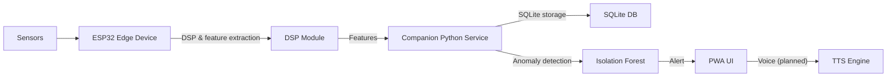

# Architecture Overview

MachineVaidya consists of three logical layers that together provide offline health monitoring:

1. **Edge sensing layer** – Low‑cost sensors (vibration, acoustic, current, temperature) attached to the machine feed raw data to an ESP32 micro‑controller.
2. **Companion processing layer** – A Python service running on a laptop or Raspberry Pi receives the streamed features, stores them locally in SQLite, and runs the anomaly‑detection model.
3. **User‑interaction layer** – A Progressive Web App (React + Vite) served by FastAPI displays health scores, trends and alerts. Voice alerts in regional languages are produced locally.

---

## Data flow diagram


- **On‑device (ESP32)** – sampling, simple filtering, computation of RMS, FFT, band‑energy.
- **Companion (Python)** – aggregates windows of features, trains a per‑machine baseline, runs the lightweight Isolation Forest model, persists results.
- **UI** – visualises health trends, shows feature‑importance explanations and stores a log of alerts for later review.

---

## Deployment topology
```
[Machine] <--sensor wires--> [ESP32] <--Wi‑Fi--> [Companion (Laptop/RPi)] <--local network--> [Browser on phone]
```
All communication stays within the private LAN; no external cloud services are required.

